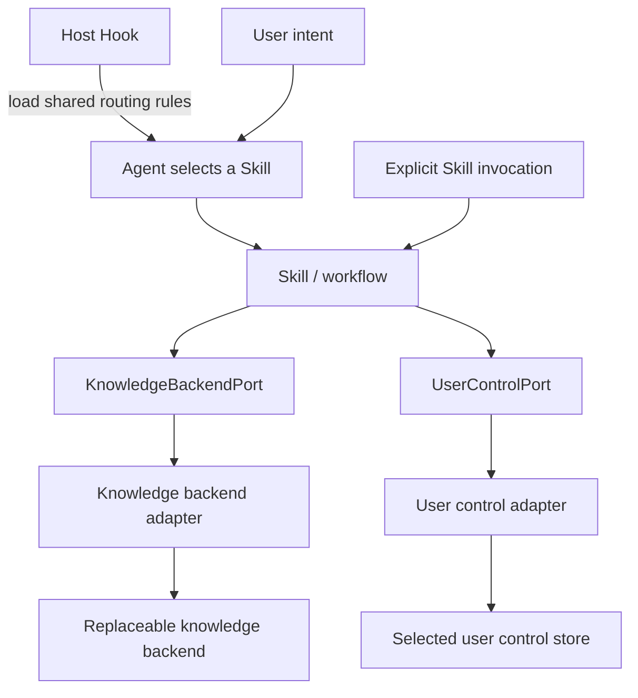
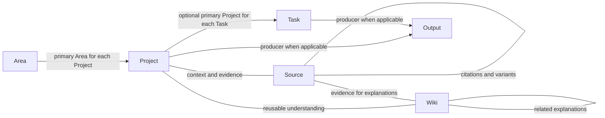
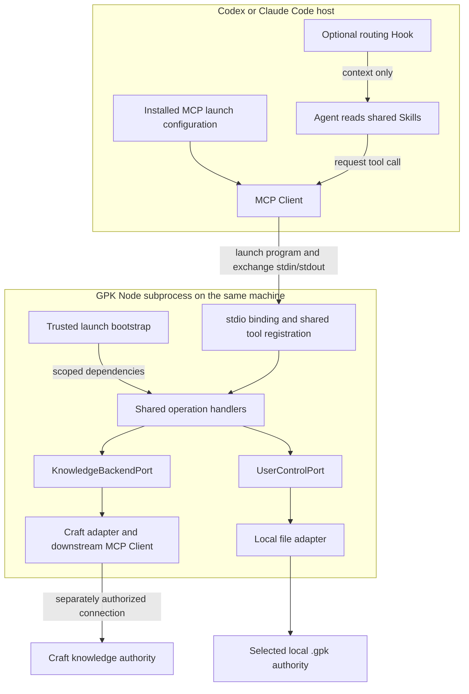
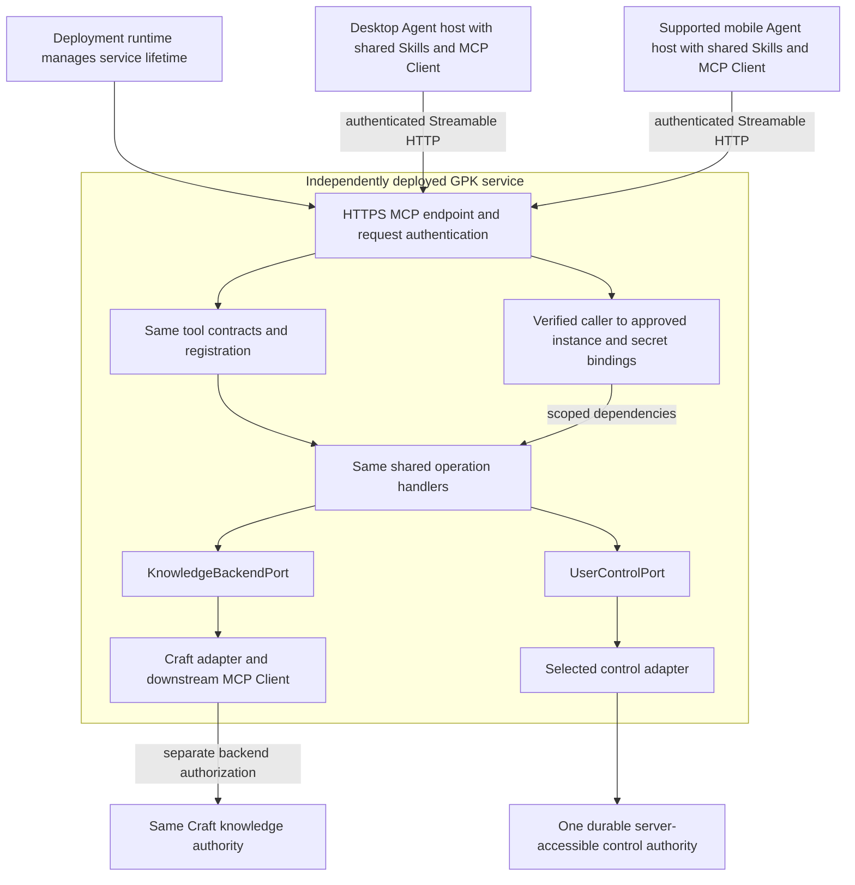
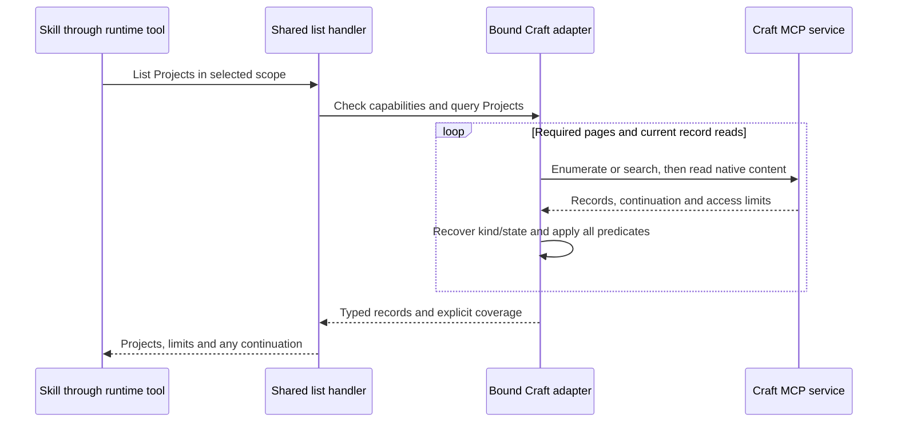

# Architecture

[中文说明](architecture.zh-CN.md)

This page starts with GPK's logical architecture: entry routing, Skills/workflows,
the domain model, storage ports and adapters. Component implementation follows separately,
covering runtime binding, connections, operations and host integration. The
[README](../README.md#current-support) remains the sole statement of current
support. Implementation examples are design illustrations, not an installed tool
inventory.

The design targets one person using Codex or Claude Code with Craft for knowledge
and an explicitly selected local `.gpk` directory for User Control. GPK keeps
meaning independent of both client and store, uses current user-owned records,
and shares deterministic rules across workflows. It requires neither
a new editor nor a central knowledge mirror, hosted GPK service or GPK scheduler.
The first runtime release is **MCP stdio only**. A later Streamable HTTP binding
reuses the same tool contracts, operations and storage ports; it is an extension
target, not another service to implement for the first release.

## Overall architecture

Skills are GPK's business core. A host Hook loads shared routing rules into the
Agent's context; the Agent uses those rules to select the appropriate Skill for
the user's intent. Explicit Skill invocation enters the same business core
directly. Skills compose knowledge and user-control operations defined by ports;
concrete adapters implement those contracts for the selected stores.



These arrows describe logical use, not process or protocol hops. The domain model
supplies the vocabulary and rules used by Skills, ports and implementations. A
workflow asks for Projects, Sources or Wiki revisions; selecting a different
conforming backend changes how those operations are fulfilled, not their meaning.
Backend products, transports and executable entrypoints belong to the
[component implementation](#component-implementation) below.

### Entry routing and the Skill core

The entry Hook is a small host binding: load the shared routing policy at session
start or context restoration, and provide a short routing checkpoint on a new
user message where the host supports it. The Agent interprets intent and loads
the selected Skill. The Hook does not classify natural language in a separate
process, run business workflows or access the knowledge backend merely to route.

Keep one shared routing policy, loaded before business Skills. Host integrations
deliver that policy through their supported instruction/Hook facilities; they
do not maintain separate intent tables. The
[shared routing policy](../plugin/rules/routing.md) owns selection and transition
behavior. Both Hooks and the manual `gpk` entry read it; the loader and policy are
packaged together as described in [entry Hook loading](plugin-runtime.md#entry-hook-loading).

Setup, Ingest, Plan, Work and Review own business judgments and workflow
composition. `gpk` remains the explanation, query and explicit fallback entrypoint;
automatic routing need not load it before every business Skill. Tool bindings,
operation handlers and adapters provide callable operations under the Skills.
They do not become another workflow engine or duplicate the Agent's judgments.

Routing bootstrap and connection bootstrap have different purposes. Loading
instructions needs no backend connection; a selected workflow resolves current
resources and access only as its work requires. An explicit request remains
usable without a Hook, and a host with different Hook facilities needs its own
validated binding. See [Hook integration](#hooks-and-execution-triggers) for
delivery boundaries and the [README](../README.md#current-support) for support.

### Example: ingest a URL

For "ingest this URL", the Agent uses the loaded routing rules to select the
Ingest Skill, or enters it through an explicit invocation. It obtains the input,
reads relevant current knowledge through `KnowledgeBackendPort`, interprets how
the material should be used and applies authorized Source, Wiki, Project or Task
changes through that same contract. `UserControlPort` supplies relevant current
preferences and grants. The Skill reports actual retained/integrated results and
any limits; the backend implementation handles physical storage.

Fetching an external URL uses an available source reader/host capability; reading
or changing retained knowledge uses the knowledge port. A port does not imply a
web reader. Neither step requires the user to invoke a GPK CLI. The complete
judgment and routing rules belong to the [Ingest workflow](workflow-design.md#ingest).

## Core components

| Component | Responsibility and boundary |
|---|---|
| Entry Hooks and routing policy | Load shared selection rules and refresh the routing checkpoint; the Agent chooses a Skill without executing business operations in the Hook. |
| Skills and workflows | Interpret intent and current context; assess relevance, outcomes and capacity; compose Setup, Ingest, Plan, Work and Review through domain operations. |
| Domain model | Define entities, relationships, states and invariants shared by all workflows and backends. |
| KnowledgeBackendPort | Describe retrieval and persistence of domain facts and processing evidence, with explicit coverage and effects. |
| UserControlPort | Discover selected control and access typed Settings, role-declared templates and separately approved grants. |
| Backend adapters | Implement the ports for selected stores while preserving domain meaning, current user content and declared capability limits. |
| Host facilities | Execute the Agent, load Skills, expose tools and provide interaction, source access and supported execution triggers. |

Skills own semantic judgment; deterministic code checks facts and effects that it
can establish. Ports define needed capabilities, and adapters implement them.
See [storage ports](storage-contracts.md#public-contracts) for the contract map.
Executable modules are an implementation of these responsibilities, not additional
conceptual layers the user must navigate.

## Domain model in the runtime

The [domain model](../plugin/knowledge/domain-model.md) owns definitions,
relationships, lifecycle transitions and operation invariants. The diagram below
shows the relationships that runtime operations must preserve, not a storage schema.



A Project has one primary Area and can relate to others; a Task has at most one
primary Project and can stand alone. Evidence/context links are many-to-many.
Outputs can also have independent purposes. Physical placement does not determine
these relationships. Objective/KRs are Project content; there is no separate Goal
entity. Capture surfaces, Project material, links and processing checkpoints are
supporting operations; Focus and Full Plan are views.

These choices shape implementation:

- [Domain types](../src/domain/entities.ts) provide typed references and state
  vocabularies. Adapters resolve a reference's kind, scope and existence rather
  than merely casting a provider ID. Read projections do not replace whole native
  documents or discard unknown content.
- Each entity declares its own operations and can evolve independently; see
  [knowledge operation contracts](storage-contracts.md#3-knowledge-backend-port).
- Area, Project and Task have their own lifecycle rules. Source, Wiki and Output
  have no universal lifecycle. The canonical transition table stays in the domain model.
- State meaning, storage encoding and query strategy are separate. A readable
  state tag does not prove a native state filter. Queries disclose actual scope,
  predicates and coverage through the [storage contracts](storage-contracts.md).
- Semantic decisions remain with the Agent/user; code verifies their required
  current facts and operation preconditions. A legal state transition alone is
  neither authorization nor evidence of a completed outcome.

## Component implementation

The following choices explain how the logical architecture runs in the initial
integration. They can evolve without changing the Skill-to-port dependency or
the domain model. Craft is the first knowledge-backend target; local `.gpk` files
are the first User Control target. Further provider
support requires its own adapter and conformance evidence.

### Runtime responsibilities

| Responsibility | Implementation boundary |
|---|---|
| Tool binding | Translate host tool input into a shared operation request and preserve its result; the initial binding uses MCP. |
| Routing bootstrap | Load the shared Agent routing policy through a supported host Hook/instruction binding; refresh a small checkpoint when appropriate. |
| Connection bootstrap | Resolve connection configuration and the minimal control locator; establish access and construct scoped adapters before control resources necessarily exist. |
| Operation handlers | Coordinate fresh reads, current grants, capabilities, domain checks, persistence and verification for a bounded operation. |
| Validation and resource lookup | Enforce deterministic rules and resolve current context/templates as an operation needs them. Semantic drafting and judgments remain with the Agent; native rendering belongs to adapters. |
| Provider adapter and transport | Implement port operations, encode native content and manage local filesystem access or authorized downstream MCP/API calls. |
| Platform integration | Load tools, routing instructions and Skills, obtain user input and translate supported host hooks/runner events into workflow intent. |

These responsibilities need not become separate modules, classes or services.
Start with one working MCP operation and its concrete local-control or Craft adapter; keep simple checks
and lookups with that operation. Extract helpers when implemented callers share
the same rule. Domain entities and operation inputs stay independently declared,
as described in the [contract map](storage-contracts.md#public-contracts). A generic
workflow engine, dynamic registry, event bus or new Harness port has no current consumer. See
[adapter development](adapters/README.md) for provider implementation guidance.

### Where the adapter runs

Decision of 2026-10-01, refined 2026-10-08: **GPK provides shared executable
operations and adapters behind MCP tools. Implement stdio first; keep a thin
Streamable HTTP entrypoint as the explicit extension. A dedicated CLI is optional.**
A callable implementation is needed to execute the TypeScript contracts. The
invocation protocol and deployment location do not belong in the domain model.

The MCP binding exposes implemented operations to the Agent; shared handlers call
the ports, and connection bootstrap supplies concrete adapters. The logical Skill → Port
arrow does not mean Markdown directly invokes a TypeScript interface. Tool names
and schemas become public contracts in TypeScript with their actual implementation;
port declarations alone do not register tools.

The explicitly requested engineering skeleton realizes this call path with
diagnostic tools and complete fail-closed adapter stubs. It performs no storage
I/O and does not satisfy the first workflow milestone. See
[current support](../README.md#current-support) and the actual
[runtime layout](plugin-runtime.md#executable-and-hook-integration).

An MCP Server may remain alive while its host connection is active. Its lifetime
does not make cached preferences, grants or domain records authoritative. It
resolves current facts through the selected connection and control authority.
Facing the host, it is a Server; calling Craft, it is a Client with its own
connection and authorization. A separately configured API transport is another
provider implementation route, validated independently.

MCP hosts manage separate client connections to servers; GPK cannot assume access
to another plugin's tools or authenticated connection merely because both plugins
are installed. Explicit host bridging can be integrated where supported and
validated. This follows the [MCP connection architecture](https://modelcontextprotocol.io/docs/learn/architecture)
and [server isolation principles](https://modelcontextprotocol.io/specification/2025-11-25/architecture).
Official [MCP SDKs](https://modelcontextprotocol.io/docs/sdk) provide both client
and server building blocks; composing them is GPK's implementation responsibility.

Manifests load tool surfaces separately from Skills. Entry-level tool permission
does not grant every downstream mutation. Shared operation grants and effective
provider permissions constrain each call. See [plugin loading](plugin-runtime.md).

### First release: local stdio

This is a process/deployment view, not a requirement that every knowledge backend
use MCP. Each authorized client may launch its own GPK process; both select the
same user-approved control root and Craft instance, not an adapter-owned shared cache.



The **host runs the program**, using the installed launch configuration. The
Skill is instruction content: it neither executes a CLI nor instantiates a Port.
The Agent requests tools; the host's MCP Client sends protocol messages; GPK's
binding calls shared handlers, which use concrete adapters through their ports.
These roles match the [Codex MCP integration](https://learn.chatgpt.com/docs/extend/mcp?surface=cli)
and [Claude Code MCP integration](https://code.claude.com/docs/en/mcp).

The initial process boundary has these requirements:

- Package one runnable Node entrypoint with its runtime dependencies per installed
  plugin, separately from Skill reference copies. Launch works outside the checkout
  and in both actual hosts; no user-facing CLI, automatic package download or
  source TypeScript compiler is required at runtime.
- Bootstrap supplies the approved instance/root and supported secret bindings.
  Start without initialized Settings or a live Craft connection so Setup and
  diagnostics remain usable. No directory guessing or permission from tool arguments.
- Write only protocol messages to stdout; send redacted diagnostics to stderr.
  Handle stdin closure, cancellation and shutdown without claiming unfinished
  provider writes were rolled back.
- Re-read current control, grants and relevant backend facts for each operation.
  Two client processes are independent writers; a process-local lock does not
  provide cross-client or native-user-edit protection.
- Keep source readers, Agent decisions, native scheduling and Hook handling in
  the supported host integration. A running MCP subprocess is not an autonomous
  Agent, conversation reader or scheduler.

### Startup and operation sequence

Discovery below is conceptual: the SDK handles the protocol version actually
supported by each client. The sequence does not require a particular handshake.

```mermaid
sequenceDiagram
    participant Host as Agent host and MCP Client
    participant Agent as Agent following Skill
    participant GPK as GPK stdio process
    participant Control as Selected User Control
    participant KB as Craft backend
    Host->>GPK: Start installed program with approved bootstrap
    GPK-->>Host: Expose implemented tools through supported MCP protocol
    Host->>Agent: Load Skill instructions and available tool surface
    Agent->>Host: Request a bounded operation
    Host->>GPK: MCP tool call
    GPK->>Control: Read current Settings, templates and grants as needed
    Control-->>GPK: Current scoped resources or explicit failure
    opt Operation needs knowledge access
        GPK->>KB: Read current facts and declared capabilities
        KB-->>GPK: Facts, coverage and revision limits
    end
    alt Authorized write with valid preconditions
        GPK->>KB: Apply bounded change through adapter
        GPK->>KB: Read back and verify actual effects
        KB-->>GPK: Verified, partial or uncertain outcome
    else Read-only or blocked operation
        Note over GPK: No mutation; preserve coverage or failure meaning
    end
    GPK-->>Host: Shared operation result mapped to tool response
    Host-->>Agent: Result, limits and recovery information
    Agent-->>Host: Continue Skill or ask user about unresolved decisions
```

Setup's control writes use the control adapter and their own readback. They are
not an atomic transaction with Craft changes; the sequence depicts a knowledge
write for brevity. Conversational confirmation alone is not a trusted grant.

### Future extension: Streamable HTTP

HTTP is an alternative **GPK-facing binding**, not a different Craft adapter or
a requirement to build a new Agent harness. For mobile operation independent of
an online desktop, the tool service must run in a reachable independent deployment.
A localhost HTTP endpoint alone does not provide that outcome.



This is a future deployment target, not a claim that a particular mobile app
loads GPK Skills or can read desktop conversation files. Host integration and
source acquisition require separate evidence. GPK still supplies operations;
the user's Agent executes semantic workflows, not an LLM embedded in this service.

| Boundary | stdio first release | HTTP extension |
|---|---|---|
| Process lifecycle | Host launches/stops a local Node subprocess | Deployment runtime manages an independent service |
| MCP entrypoint | stdin/stdout binding | Streamable HTTP endpoint, with protocol compatibility checks |
| Caller scope | Trusted approved launch context and current operation grants | Validated request identity mapped server-side to an approved instance; current grants still apply |
| Shared behavior | Tool schemas, handlers, domain rules and storage ports | Reuse unchanged semantics and shared acceptance fixtures |
| Control authority | One explicitly selected desktop `.gpk` root | One durable server-accessible store; a single-user deployment can reuse the file adapter on a persistent volume |
| Craft access | Adapter's own authorized client on the desktop | Same adapter, with service-side backend access and secrets; no inherited desktop login |
| Agent facilities | Client-side Skills, Hooks, readers and native scheduling | Remain client-specific; HTTP does not transfer host capabilities |

The extension seam is ordinary dependency injection: a transport entrypoint
obtains a **trusted, bounded execution scope**, constructs the selected adapters
and invokes the same tool registration and shared operations. Local paths,
authentication tokens, SDK request objects and protocol session state do not enter
domain requests. Do not accept a model-supplied user ID, grant or root as proof of
authority. Concrete TypeScript signatures are defined with the first working
consumer, not duplicated as new speculative ports in this document.

Use the official [MCP TypeScript SDK](https://github.com/modelcontextprotocol/typescript-sdk)
for protocol handling and select/pin a version after verifying both initial hosts.
Protocol revisions, SDK major versions and JSON-RPC 2.0 are distinct. The
[2026-07-28 MCP revision](https://blog.modelcontextprotocol.io/posts/2026-07-28/)
introduces a stateless core, but host uptake must be tested; neither compatibility
state nor a long-lived process may become GPK's fact or grant store. The future
transport is [Streamable HTTP](https://modelcontextprotocol.io/specification/2026-07-28/basic/transports/streamable-http),
not a new proprietary REST domain API or the deprecated HTTP+SSE transport.

### Migration and implementation boundary

Implement the first vertical slices on stdio: runnable isolated package and
diagnostics; local-control access and repeatable Setup; scoped Craft reads; guarded
Plan/Work changes; then Ingest, Review and actual host-triggered processing.
Add concrete modules as those slices need them; do not create empty HTTP adapters,
a second handler implementation or a generic workflow/transport framework.

HTTP implementation is explicitly deferred. It must later:

1. Add the HTTP entrypoint around the same implemented tools/handlers and run
   their shared fixtures over both bindings, including partial/uncertain effects.
2. Authenticate requests and validate endpoint/origin exposure before selecting
   an instance. Verify tokens and resource scope on each request, not client
   metadata or a remembered connection. An authentication service may be external;
   a custom GPK account system is not required. See
   [remote MCP authentication](https://developers.openai.com/plugins/build/auth).
3. Select durable service-accessible User Control and rebind secrets/backend
   authorization in that execution environment. A persistent server `.gpk` volume
   can reuse the file adapter; a service/database adapter is needed only when the
   deployment actually requires it. Ephemeral server disks cannot be the authority.
4. Preview, transfer, verify and explicitly cut over control resources and client
   locators to one authority. Re-evaluate grants and secret references. Do not
   silently fall back to local control, keep two independent writers or add hidden
   synchronization. Craft facts stay in Craft; no knowledge mirror migration.
5. Test independent restart, changed/revoked access, caller isolation, concurrent
   edits, request interruption and retry through actual desktop/mobile clients.
   Inspect retained effects before retrying; stateless transport is not exactly-once
   execution. Unsupported safe overlap must remain explicit.

First release excludes the HTTP listener, public endpoint deployment, remote
authentication integration, multi-user service, cloud synchronization and a GPK
Agent/scheduler. These are not prerequisites for stdio completion. The
[acceptance inventory](conformance-scenarios.md#implementation-acceptance) owns
the concrete stdio and future HTTP verification cases; the
[roadmap](roadmap.md) owns product delivery milestones.

### Optional CLI

A dedicated CLI can be added for a concrete terminal, script or diagnostic use
case. It is not required for installation, Setup, normal Skill workflows or the
initial runtime milestone. Starting an MCP Server with a host-configured process
command does not require a user-facing set of GPK CLI commands.

If added, a CLI command such as `gpk projects list --json` and an MCP tool such as
`gpk_projects_list` must invoke the same handler and use the same connection
configuration. Presentation may differ; domain results, coverage, limits,
verification and recovery must agree. MCP tools must not shell out to this CLI,
and Skills must not depend on its presence. Supporting multiple entrypoints is
an extensibility rule, not a requirement to deliver every entrypoint at once.

## Setup and connection lifecycle

**Onboarding surface (decision of 2026-10-12).** Setup is a web page, not a
conversation. `gpk_setup_open` starts a server on `127.0.0.1` inside the
runtime process (`src/onboarding/`) and opens the page in the user's browser.
The page connects a knowledge base from a catalog (Craft is the only available
adapter; the others are shown as coming soon and refused by the server; the
OAuth callback returns the browser to the page), lets
the user choose a dedicated or shared workspace, a working and a metadata
language and the names, creates the structure, and writes the permissions the
user ticks. Its only products are `settings.json` and `grants.json`.

- **Consent stays with the user.** No MCP tool writes grants or runs layout
  establishment; the Agent can open the page but cannot confirm it. A grant
  the page submits must be a subset of the proposal, so the page cannot widen
  authority either.
- **Onboarding gates everything.** Until Settings exist and at least one
  grant is persisted, runtime status reports `onboarding: required` and every
  knowledge operation, reads included, fails `unavailable` with a `next` step
  naming `gpk_setup_open`. Only the capability inventory, which reads no
  records, stays available.
- **Loopback hardening.** Any website can send requests to `127.0.0.1`, so
  the server checks Host against DNS rebinding, requires a session cookie on
  every request, requires a same-origin `Origin` and `Sec-Fetch-Site` on writes,
  accepts only JSON bodies, and stops after 30 idle minutes or with the runtime.
- **The Agent holds no confirming credential.** `gpk_setup_open` mints a
  one-time launch token and gives the URL to the browser; the first load trades
  it for an HttpOnly, SameSite=Lax session cookie and the URL stops working.
  The tool result carries the URL only when no browser could be opened. If an
  Agent spends that URL, the user's link shows as expired, so misuse is
  visible. Residual risk, accepted: a process running with the user's local
  privileges can forge browser headers or edit `grants.json` directly, so no
  loopback design proves that a human clicked. The boundary is that GPK never
  hands the Agent a credential or a tool that confirms.
- **Remote deployment.** The page's handlers call `Operations` only, so a
  remote GPK serves the same page behind an authenticated session instead of a
  loopback token; the OAuth callback then moves to the service's public URL.
- **Languages.** The working language governs conversation and record content;
  the metadata language governs structural names and template headings. Schema
  keys (the `Status`/`Area` columns), state values and `#gpk/task/*` tags stay
  English, so records stay machine-readable whatever either language is.

Setup selects local control before establishing knowledge-backend access. Installing
the Craft plugin is optional: an existing Craft MCP service endpoint may be used, but its
host-held session or credentials are not implicitly transferable. Craft documents
[configuring its MCP connections for other clients](https://support.craft.do/en/integrate/mcp).
The actual connection's authentication and capabilities still need verification.

Connection bootstrap follows this sequence:

1. **Select and inspect local control.** Resolve the explicit instance and stable
   `.gpk` root; verify authorized filesystem access and read existing Settings.
   Do not scan the machine, select a parent directory implicitly or create one
   control store per Project/client. The root is not a plugin-install/cache directory.
   Confirmed never-initialized Settings permits a proposal; known missing, invalid
   or inaccessible resources require recovery, not defaults or another authority.
2. **Select the knowledge connection route.** Use the existing active configuration
   or the user's first-use choice. The verified route is GPK's own MCP client to
   the Craft MCP endpoint: discovery from the 401 challenge, dynamic registration
   of a public client, PKCE authorization through the user's browser with a
   loopback redirect, and persisted tokens with refresh. Do not scrape another
   plugin's token files or reuse the host connector's session.
3. **Authenticate once per instance.** The first Setup opens the authorization
   page; the user approves the space in the browser; later process starts reuse
   the stored tokens without interaction. Refresh tokens rotate, so the new pair
   is persisted before the old one is discarded. Revocation takes effect within
   the access token lifetime, not immediately. API access is a separate adapter
   with its own configuration and evidence, not an automatic fallback.
4. **Verify backend access.** Establish the protocol connection, inspect actual operations,
   resolve provider/space identity from connection metadata and verify a scoped
   read. Record limitations; a readable connection does not prove write support
   or complete workspace access. Any write probe requires its own bounded
   authorization. See the [Craft mapping](adapters/craft.md) for the dated evidence.
5. **Save bootstrap and complete business Setup.** User-side host/local bootstrap
   keeps the selected control locator and host secret/profile bindings. It is
   not a second Settings database. Credential-bearing URLs remain secret references.
   All exposed runtime bindings reuse that seed; an optional CLI needs no second setup.
   Verify the selected layout and resources before initializing/updating typed
   Settings. Adopt only requested personal templates under the
   [Setup workflow contract](workflow-design.md#setup), then read back the results.
   Local control and Craft writes are independent effects. Connecting alone does
   not create templates, migrate content, activate work or register a timer.
6. **Report separate readiness.** Distinguish transport access, selected control
   authority and operation capabilities. After partial failure, retain valid
   connection configuration and recover resources; do not report the instance
   fully configured or recreate resources blindly.

Before control resources exist, the current user/host authorization can permit
the bounded initial Setup operations. It is not a fabricated persistent grant or
blanket permission for later work; subsequent operations use current authorization
and the selected control authority. The provider authorizes GPK's own OAuth
client, not the host's connector: Craft lists GPK as a separate connection whose
scope and revocation are independent of Claude Code's or Codex's. One GPK
instance holds one client registration and one token set, stored in a
host-neutral secret store on the machine and keyed by instance, so a process
launched by either harness reuses the same authorization without a second
browser approval. Because refresh tokens rotate, two concurrent GPK processes
can race: a refresh that fails re-reads the store first, since the other process
may already have saved the new pair, and only then falls back to re-authorization.
The [storage contracts](storage-contracts.md#4-user-control-port) define the
three authorization layers and the grant resolution rule that every knowledge
mutation follows.

Normal calls reuse the selected configuration. Credential refresh follows the
chosen provider mechanism; revoked or expired access stops dependent operations
and requests reconnection when needed. Repeated Setup verifies and changes the
selected configuration instead of resetting the instance. Missing access to a
known control store is an error, not evidence of a new installation.

Bootstrap supplies the selected local root before reading User Control. The
[local control mapping](adapters/local-control.md) owns file layout and scope.
Settings owns backend configurations and safe MCP/API descriptions; sensitive
endpoint/credential contents stay in host secret facilities under logical references.
Bootstrap is only the access seed for control. Settings, templates, grants and origin
policy remain in the selected authority. Personal background stays in a referenced
Wiki or relevant Area/Project content, not a duplicated control Profile. The
[data ownership contract](storage-contracts.md#1-two-storage-ports-and-the-host-boundary)
defines this split. Authorized Codex and Claude Code clients on the same machine
can share that root without copying Settings. Local Settings/templates remain
readable when Craft is offline; dependent domain work stops until backend access
recovers, without resetting control. A new device or cloud session does not
automatically have local-file access. For a remote deployment, choose durable
server-accessible control as described in the [HTTP extension](#future-extension-streamable-http),
with explicit verified cutover, not implicit sync/fallback. A service-backed
provider is an option, not required merely because the entrypoint uses HTTP.
Note-backed control is not an initial target; reconsider only with an appropriate
native/plugin-private configuration surface, not ordinary visible knowledge notes.
A bridge available only inside one host does not establish access elsewhere.

The Setup Skill must be able to establish this configuration through the host's
GPK tools and user interaction. The runtime starts without an existing backend
connection and exposes connection setup/diagnostics before storage operations are
ready. No `gpk setup` terminal command is required.

The first implementation must select concrete bootstrap/secret facilities for
each supported execution environment and validate the exposed tool binding.
No custom credential database or host-token extraction is implied by this design.

### Typed Settings and onboarding

[UserControlPort](../src/domain/user-control-port.ts) exposes named Settings,
template and grant groups, not a generic KV interface. Nested preferences,
backend selection/configurations, per-backend layout locations, template binding
and automatic-ingestion choices have explicit consumers and declared defaults.
Layout describes placement, not a domain schema or ownership. Multiple stored
configurations select exactly one active backend; no federation or silent fallback.
The current host supplies Agent capabilities rather than a mutable Agent-ID setting.

One template operation group serves Area, Project, Task, Source, Wiki and Output.
Settings has six named personal bindings; null selects the corresponding bundled
default. Creation declares a role, content updates retain it, and binding validates
the resource's role and meaning. Bundled defaults are available without six personal
copies or new domain documents. Task stays a lightweight inline fragment. Template
choice/persistence is separate from native rendering and domain writes.

Setup is the principal configuration writer; plugin onboarding is its first-use
path. Success is complete valid Settings initialization with verified active
connection/layout and selected resources, followed by persistent readback. There
is no independent onboarding-completed boolean. Defaults include English language,
bundled template choice and disabled automatic/daily ingestion; actual placement,
grants and access cannot be invented. Onboarding need not collect a Profile or
enable optional automation. A later connection failure does not erase initialization.

The following variants describe **GPK → knowledge backend** access, not the
first-release GPK-facing binding. MCP HTTP targets may be safe public URLs or
secret references; stdio selects an approved host connection profile, and host
bridging needs a validated explicit
bridge reference. API is a separately selected route. Declaring these variants is
not an implementation/support claim. Another host may need to authorize logical
credential/profile references; raw credentials are never copied through Settings.
Ordinary Settings changes cannot grant permissions or automatically run configured
commands. Backend/control cutovers require explicit verification; keep current
facts, personal references, templates and grant scope coherent without implicit migration.

## Workflow and operation execution

### Shared execution pipeline

Entry routing has already selected the business Skill before this operation
path begins. Selecting an operation here is tool dispatch, not another natural
language Skill router.

Skills compose implemented operations. Implement an operation as an ordinary
function; the tool binding decodes its input and preserves its result. A simple
read handler can call the port directly. The steps below are a behavior checklist,
not a pipeline interface or a mandatory chain of middleware objects.
An optional additional entrypoint calls the same operation. Public schemas, operation inputs
and results belong in TypeScript beside their actual consumer; storage contracts
remain in [src/domain](../src/index.ts).

| Stage | Work performed | Stop boundary |
|---|---|---|
| Decode and dispatch | Validate external input, select an implemented operation and distinguish read-only intent from mutation | Invalid/unsupported input never reaches a write |
| Connect and bind | Resolve connection and control locator; construct scoped adapters | Missing or ambiguous access stops dependent work; connection Setup can run before control exists |
| Load current facts | Read relevant resources, target records, dependencies and actual capabilities | Partial/unknown coverage cannot establish absence, uniqueness or complete review |
| Assess and guard | Obtain required Agent/user decisions; check current grants, entity rules and supported revision expectations | A fully specified command can proceed; unresolved judgment returns to its caller without guessing |
| Execute | Call ports; adapters validate native data, render or narrowly edit supported content | No hidden permission expansion, provider fallback or cascade |
| Verify and recover | Read back effects; retain verified progress/recovery evidence when needed | Ambiguous effects require inspection before retry; successful steps remain successful |
| Present | Return normalized results to the calling Skill/tool consumer | Formatting cannot hide partial results, uncertainty or failures |

Authorization and invariant checks also apply at the port implementation boundary
using shared code. A direct adapter call cannot bypass them. Preconditions and
readback are mandatory pipeline steps, not optional hooks.

### Core operation families

This inventory maps implementation responsibilities; it does not add methods to
the public ports or promise that every domain operation is one command.

| Family | Handler implementation | Contract/detail owner |
|---|---|---|
| Setup and connection diagnostics | Bootstrap transport; verify scope; discover/select control; adopt resources; report read/write readiness separately | [Setup](workflow-design.md#setup) and connection lifecycle above |
| Read/list/search | Resolve typed targets or perform scoped queries; follow requested continuations; preserve record and discovery coverage separately | [Entity-specific read/query contracts](../src/domain/knowledge-backend-port.ts), [query guarantees](storage-contracts.md#state-representation-and-query-guarantees) |
| Area operations | Persist explicit direction/state/relationship changes; review judgments stay with the Agent | [Area operations](../src/domain/knowledge-backend-port.ts) and domain model |
| Project operations | Compose creation, primary-Area assignment, Task ordering, process material and reviewed transitions; preserve significant decisions | [Project operations](../src/domain/knowledge-backend-port.ts), Plan and Review |
| Task operations | Handle accepted actions, parent assignment, one planned time, state and useful result return | [Task operations](../src/domain/knowledge-backend-port.ts) and Work |
| Source, Wiki and Output operations | Persist retained evidence, current explanations and artifact references; preparation/synthesis/retention decisions come from workflows | [Knowledge entities](../src/domain/knowledge-backend-port.ts) and Ingest/result return |
| Captures, links and checkpoints | Address native capture surfaces, contextual links and verified processing progress without raw-content bypasses | [Supporting operations](../src/domain/knowledge-backend-port.ts) |
| Control and templates | Read/write selected resources; distinguish unset from inaccessible; resolve a current template before applicable creation | [User Control](../src/domain/user-control-port.ts), [templates](workflow-design.md#3-templates) |
| Preservation operations | Compose scoped archive/restore, deletion or restructuring only with supported reference and recovery handling | Domain model and [effect boundaries](storage-contracts.md#content-and-effect-boundaries) |

Setup, Ingest, Plan, Work and Review are Agent workflows that compose these
families. They are not five autonomous Node commands that reproduce all Agent
judgment. A runtime tool may accept bounded intent or an assessed action,
but it must declare which part it executes and return unresolved choices to the
Agent/user. The [workflow design](workflow-design.md) owns those decisions and
stop boundaries. A trigger needing interpretation, synthesis or outcome judgment
must launch a supported Agent execution; a Node process alone does not supply an
LLM or complete an Ingest/Review workflow.

### Example: list all Projects



A list handler uses the selected adapter's query implementation. An exhaustive
route traverses the relevant authorized population; a search route may only
produce candidates. Requesting all results drives available continuation within
a bounded budget, but cannot upgrade a degraded search into a complete inventory.
The result reports incomplete scope when traversal, access or current-state
coverage is insufficient, regardless of the calling surface. Listing does not
repair state markers.

### Example: create a Project and its plan

The Plan Skill frames Objective/KRs, resolves the primary Area, reads commitments
and obtains any activation decision. The runtime resolves the current template,
validates required references and supported rendering, creates the Project, then
creates/assigns known Tasks and establishes order/material/links as needed. Each
effect returns its actual reference and is verified independently. If a Task
write fails after the Project exists, report the saved portion and resume the
remaining plan without creating another Project. A saved plan and an active
commitment remain distinct results.

### Example: complete a Task or close a Project

Work supplies an assessed Task result. The handler reads the Task and relevant
current context, records useful results and persists the justified transition
through shared guards. A result write succeeding while the transition fails is
reported as two effects. External artifact/execution evidence is checked through
available host capabilities; a successful GPK write does not prove that external
work happened or complete the parent Project.

Project closure uses Review's outcome assessment and explicit disposition of
remaining Tasks. The handler needs adequate coverage of those Tasks and current
Project evidence, applies the agreed Task effects, then persists the accepted
Project transition. Incomplete evidence or an unfinished dependent effect stops
closure. Code checks the presence and consistency of the required assessment;
it does not infer KR attainment from headings or checked boxes. The first working
caller must settle the draft write contracts around this evidence, rather than
assume a transition reason string proves it.

### Example: resume Ingest after partial success

The source reader supplies bounded, attributed input. Ingest resolves work
identity, reads backend progress and distinguishes changed input from completed
destination effects. Preparation and semantic routing use the Agent; handlers
persist the resulting Source/Project/Wiki/Task changes. Verified acquisition and
integration progress advance separately. If Source and Project changes succeed
but Wiki fails, inspect current effects and retry only the Wiki work. Transport
retries must not blindly replay uncertain mutations; a checkpoint is neither an
atomic lock nor an exactly-once guarantee. Detailed behavior belongs to
[source processing and recovery](workflow-design.md#5-generic-source-processing-and-periodic-execution).

## Hooks and execution triggers

### User automation versus internal feature processing

Classify by the requested behavior and ownership, not by whether implementation
uses a clock or Hook:

- **User-requested automation:** the person asks for recurring business work,
  such as "clean my Inbox by these rules every day" or "update my weekly report
  from sessions every day." Use the selected Agent harness's supported scheduler
  to invoke the applicable GPK Skill. The purpose, business cadence and rules are
  user choices. If that capability is unavailable, report the limit instead of
  silently adding a GPK scheduler or service to fulfill the request.
- **Internal feature processing:** the person enables a product feature such as
  automatic session retention. GPK owns change capture, batching, processing,
  deduplication, recovery and its integration lifecycle. Hooks, timers or their
  combination are implementation choices; the user need not create or maintain
  a recurring business task to make the feature work. Reusing a host scheduler
  underneath does not change this ownership, nor does an internal interval turn
  the feature into user-requested automation.

Feature enablement declares its approved origins, retention and downstream scope;
it is not permission to collect every session or expand grants. Users control the
feature and can inspect useful effects and failures without managing its internal
trigger choice. Disabling it or revoking scope stops affected processing and
reconciles its own registrations, without changing unrelated user automations.
Policy and registration references belong in User Control; retained input and
verified/pending effects belong in the Knowledge Backend. Actual trigger state
belongs to the executing host/runtime, never an adapter-owned facts database.

Both paths reuse the same Skills and operation guards. This distinction requires
neither a new Skill/domain entity nor a custom timing service by default. A trigger
still needs a supported Agent execution environment for semantic Ingest; a timer
or running MCP process alone does not supply one. Validate the feature's declared
execution window and catch-up behavior rather than hiding unavailable execution.

### Trigger delivery and operation boundaries

Distinguish entry routing, external workflow triggers and required stages inside
an operation. They have different consumers and effects.

| Mechanism | Role | Implementation boundary |
|---|---|---|
| Session/context Hook | Load shared routing instructions before business Skill selection | Inject Agent-readable policy; no business execution or implicit backend scan |
| User-message Hook | Remind the Agent to select or continue the appropriate workflow | Small checkpoint referring to the loaded policy; no duplicate intent table or standalone classifier |
| Internal preconditions and post-write verification | Always enforce authorization, invariants and actual effects | Ordinary operation code; cannot be disabled by omitting a hook |
| Host lifecycle/tool hooks | Offer context refresh or request scoped result return/Ingest when an observed event makes it useful | Platform integration translates a supported event into intent; shared workflow handles meaning |
| User-requested scheduled trigger | Run recurring business work at the user's requested cadence | Selected harness scheduler invokes the applicable Skill and owns actual job state |
| Internal feature trigger | Capture and process changed session material for an enabled feature | GPK manages its implemented Hook/timer integration and processing lifecycle; timing is not a user business task |
| Manual invocation | Explicit request for the same workflow/operation | Works without host hooks; does not establish periodic execution support |

Session and message Hooks prepare Agent routing. Source/tool events and runners
request bounded workflows after routing. Neither Hook output nor a selected
Skill grants additional authority; the workflow reads current grants and each
operation enforces its required guards. Loading policy does not establish a
connection, initialize User Control or register a recurring job.

Add progress/reporting integration only when an implemented binding needs it;
there is no callback registration layer to build in advance. A reporting failure
after a verified write does not undo the write or justify replaying it.

Session availability, newly available source material or finished tool activity
are candidate events, not claims that both target clients expose identical hooks.
A tool-finished event is not proof a Task is complete. Exact hook names, payloads,
registration files and delivery guarantees belong to the platform integration
when implemented. Missing hooks leave manual invocation available and their
automation capability unavailable; no fake successful registration is reported.

A registered hook/runner supplies bounded instance, origin scope and intent. Each
run re-enters the common execution path, reads current grants and backend progress,
and applies the same rules as manual execution. Duplicate/reordered events and
offline periods are reconciled against current facts. Exclude generated receipts
and outputs where needed to prevent self-triggered ingestion. Unknown payloads or
unresolved authorization stop the affected run; a Source or hook payload cannot
expand grants.

Hook registration and schedule creation require the applicable user-request or
feature-enablement authorization. The host/runtime owns actual registrations;
User Control stores intended policy and the reference used to reconcile it.
Disabling policy or revoking access stops dependent execution even if a stale
event arrives. A running MCP Server is not a scheduler. A next-session hook is
not a substitute for an explicitly requested timed run. If a
workflow needs Agent judgment, the selected runner must actually provide that
execution environment. See the authoritative
[periodic execution contract](workflow-design.md#5-generic-source-processing-and-periodic-execution).

## Existing knowledge bases (deferred decision)

The first release targets a knowledge base that GPK sets up itself: a fresh
Craft workspace with the structures at its top level (the default), or a
dedicated namespace folder in an existing space. In both
cases GPK writes only inside the structures Setup created and treats
everything else in the space as read-only material it may search and link
but never edits, moves or classifies. Adoption of an existing folder or
Collection as a GPK location is implemented but offered only when the user
names the structure; it is not part of the default plan.

How GPK should relate to a pre-existing body of notes beyond that (treating
the old space as a read-only legacy backend, promoting individual documents
into GPK locations with recorded provenance, filtering legacy Tasks out of
Focus, or learning the user's own organization) is deliberately undecided.
The evidence gathered so far lives in
[docs/research/知识库插件与模板结构调研.md](research/知识库插件与模板结构调研.md):
every product surveyed isolates its own output in a namespace, every
methodology author advises a fresh start with the old material frozen as
cold storage, and Craft confines links to one space. Decide this after the
first end-to-end milestone, with usage evidence from the fresh-space path.

## Classification and archiving (decisions of 2026-10-12)

- **Tables only where the set is bounded.** Areas (enumerable) and Projects live
  as two tables on the home page. Sources, Wikis and Outputs stay documents in
  folders: they are long-form and keep growing, and Craft recommends keeping a
  Collection under about 1,000 rows, with no item templates and no views shown
  outside the document that holds the table (see the 2026-10-12 checks in the
  [Craft mapping](adapters/craft.md)).
- **No type tags for now.** Tags would serve people only (the Agent reads type
  from the body and finds records through search), and the owner browses
  material by domain or topic, not by type. A topic or domain tag system and a
  folder classification for Sources/Wikis/Outputs are deferred until real use
  shows what to browse by. One candidate to weigh then: a topic Wiki that the
  related Sources link to already gives a topic view through Craft's backlinks.
- **Archiving completed Projects is manual.** The default Projects view shows
  open work; the user may copy a finished Project elsewhere. Craft refuses to
  move a row out of its Collection, and GPK stores no Project IDs, so this
  breaks nothing in GPK; links pointing to the old row stop resolving.

## Data authority, failure and recovery

The [storage contracts](storage-contracts.md) own persistent-data authority,
coverage and effect guarantees. Architecture follows three boundaries: domain
facts/progress in Knowledge Backend, personal resources/grants in selected User
Control, and access bootstrap/actual job registrations in the executing host/runtime
facilities (desktop host initially; service runtime for a remote deployment).
Adapters own no persistent truth. The selected control store and Craft
Knowledge Backend have independent writes; neither makes the other's effects atomic.

Failures retain their meaning across tool calls and workflow triggers. Validation
or access failure stops before the affected write; partial or uncertain failure may follow actual
effects. Re-read before retrying, preserve intervening user edits and report
verified, pending and conflicting effects separately. Supported revision guards
provide only their actual backend guarantees; process-local serialization cannot
protect against edits from another client. Unattended overlapping writes require
validated runner/backend coordination or must be reported unsupported.

Diagnostics expose the operation, stage, bounded scope, limits and recovery action
without dumping credentials or private document bodies. Optional diagnostic output
must not corrupt tool protocol streams or any optional CLI machine output. Logs
are diagnostic material, not a replacement for backend recovery evidence. Canceling a caller or
losing a process does not prove that an in-flight write failed or undo its effects.

## Code and packaging boundaries

| Location | Ownership |
|---|---|
| `src/domain/` | Entity data/references/states in `entities.ts`, knowledge and user-control contracts in their respective `*-port.ts` files, and shared inputs/results in `operation-types.ts`; shared deterministic rules added as implemented |
| `src/adapters/` | Concrete Port implementations; requested skeleton methods fail closed until real provider operations are validated |
| `src/runtime/` and `src/mcp/` | Protocol-independent handlers/bootstrap, tool schemas/registration and the stdio entrypoint |
| `plugin/` | Only Agent content read at runtime: shared routing rules, Skills, domain guidance, procedures and templates |
| `platforms/` | Host metadata and entry Hook loading configuration; tool configuration accompanies its first implementation |
| `docs/` | Architecture, workflow/contract design, provider evidence, acceptance and delivery guidance |
| `dist/` | Generated types, installable packages and archives with separate ownership inventories |

Domain data and operation contracts belong together. `Port` identifies the role
of an interface implemented by an adapter; it does not require a separate layer
or directory. The dependency direction is concrete adapters → domain contracts;
within the domain, contracts use entities and shared operation types. Runtime
composition imports concrete adapters; operation handlers work against contracts.
Domain code does not import a host SDK, Craft API, CLI parser or MCP SDK. Entry
adapters import shared handlers, never duplicate their rules or require CLI output scraping.

Adding executable code requires building and packaging it with its runtime
dependencies, registering each exposed surface deliberately and validating
isolated installation. CLI packaging is needed only if that optional surface is
implemented. Shipping `.d.ts` files or adding a manifest entry alone cannot
produce a working tool. Actual file/loading rules belong to
[plugin runtime](plugin-runtime.md); build/release rules belong to
[distribution](distribution.md). Do not edit generated output or put design-only
Skills or placeholder hook files into the product. The explicitly requested
engineering-skeleton Skills and unsupported adapter implementations are a scoped
exception, not proof of implemented workflows or backend conformance.

## Delivery and verification

Deliver vertical slices: shared entry routing and a validated host loader;
one scoped read handler callable by a Skill through the MCP binding with working
Craft access; repeatable Setup through the host and
current control/template discovery; guarded
operations for Plan/Work; then Ingest, Review and verified automated execution.
The [roadmap](roadmap.md) owns product milestones and their completion criteria.
Write contracts remain draft until the
first provider caller settles them; stable reads are described in
[storage contracts](storage-contracts.md#public-contracts).

Verification must distinguish shared-rule checks, entrypoint parity, real provider
behavior, composed Agent workflows and installed-host execution. The
[conformance scenarios](conformance-scenarios.md#implementation-acceptance) own the
acceptance inventory, including connection Setup, tool-to-handler equivalence and
hooks. Validate the exposed binding, direct user edits, lost responses, revoked
grants, fresh processes and actual host/runner execution. Add cross-entrypoint
parity checks when an optional CLI or another binding is implemented. Packaging and
type checks do not establish live Craft effects or cross-host portability.

Connection/secret facilities, provider protocol support and exact host hook/runner
mechanisms must be selected and proven by each integration. These are bounded
implementation decisions, not permission to change domain rules or silently
substitute another authority. Record evidence with the applicable provider and
scenario, rather than claiming support from this architecture.

## One authoritative body per subject

English documents are authoritative; Chinese companions explain the same design.
This page owns runtime composition and execution architecture. It summarizes the
domain only to explain implementation; detailed definitions, workflow judgments,
public signatures and behavioral guarantees remain with their owners.

| Review question | Authoritative source |
|---|---|
| Why does GPK exist, for whom, and what works now? | [README](../README.md) |
| Which user needs and situations must the product serve? | [User needs and scenarios](requirements.md) |
| What do entities, relationships and operations mean? | [Domain model](../plugin/knowledge/domain-model.md) |
| How does intent select a Skill? | [Shared routing policy](../plugin/rules/routing.md) |
| How do context, templates and workflows behave? | [Workflow design](workflow-design.md) |
| What crosses the storage boundaries? | [TypeScript contracts](../src/index.ts) and [contract map](storage-contracts.md#public-contracts) |
| Who owns data; what do coverage, effects and recovery guarantee? | [Storage contracts](storage-contracts.md) |
| How does a concrete provider represent and implement it? | [Provider mappings](adapters/README.md) |
| What behavior must be demonstrated? | [Conformance scenarios](conformance-scenarios.md) |
| What ships, how is it loaded, and how is it released? | [Plugin runtime](plugin-runtime.md) and [distribution](distribution.md) |
| How can the current foundation be tried? | [Getting started](getting-started.md) |
| What is delivered next? | [Roadmap](roadmap.md) |
| What must a contribution preserve? | [Repository instructions](../AGENTS.md) |

When requirements change, edit their owning body and affected summaries, mappings
and checks. Preserve one current decision; do not leave superseded alternatives
as competing rules. Observed provider limits must be reported rather than silently
relaxing domain meaning. Refresh generated packages from their canonical sources.

## Product artifacts and private knowledge

Reusable specifications, architecture, Skills, templates, code, tests and drafts
live in this repository and must be reviewable without private notes. Personal
Project plans, user context, research history and review notes stay in the selected
knowledge backend. Product files must not include the owner's actual Area
membership, responsibilities, finances, personal OKRs or time allocation; generic
concepts and synthetic examples suffice.

Private records may link to repository artifacts. Distributable work must not
depend on private note URLs, IDs, titles, personal workspace paths or instructions
to consult private material. Include authorized product requirements and reasoning
directly with repository-local or public references. Removing a private link does
not make personal background publishable. Each artifact retains one authoritative
body; its producing Project/Task keeps a useful summary and artifact/revision link.
Temporary context is not a competing Project, Task or control database.
