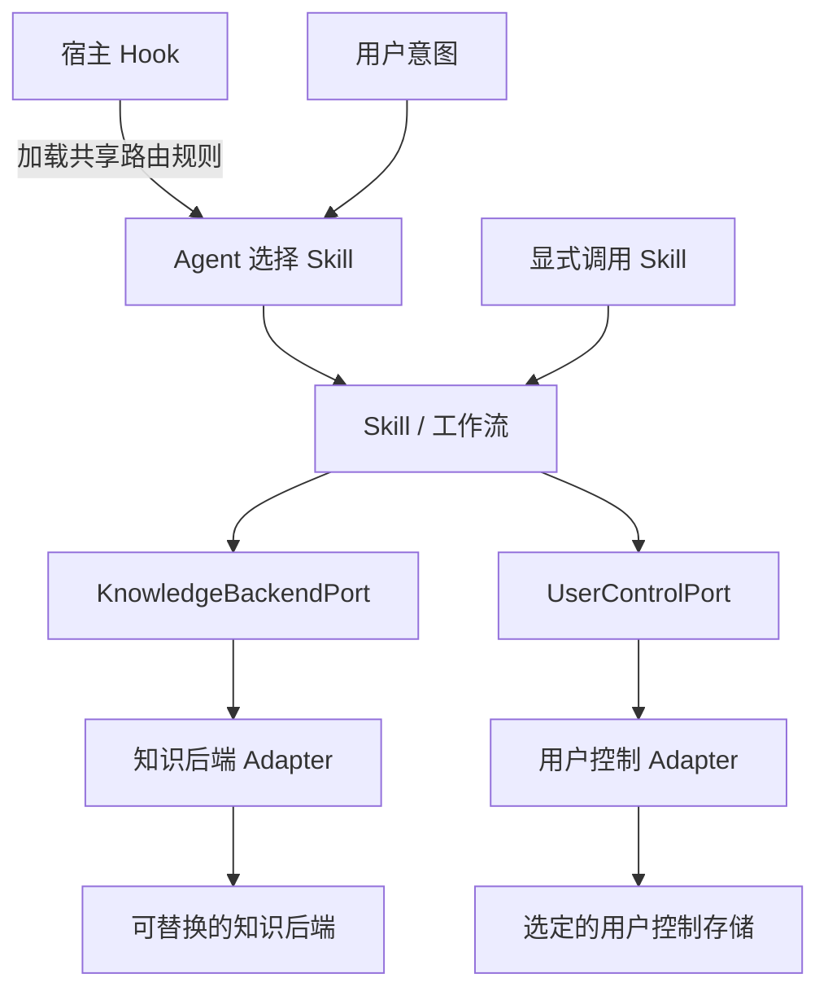
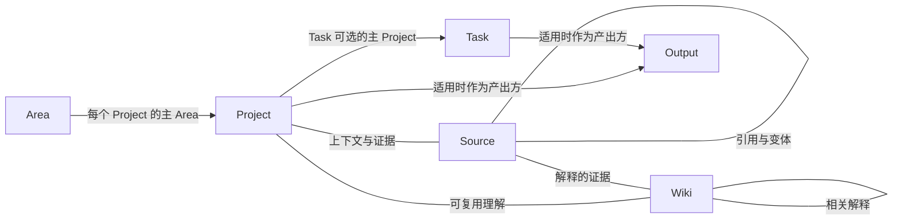
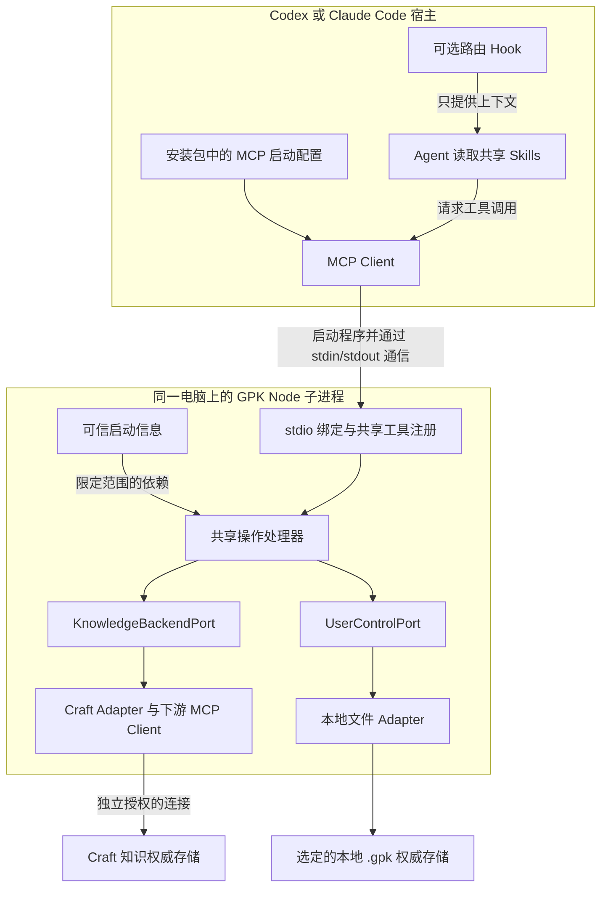
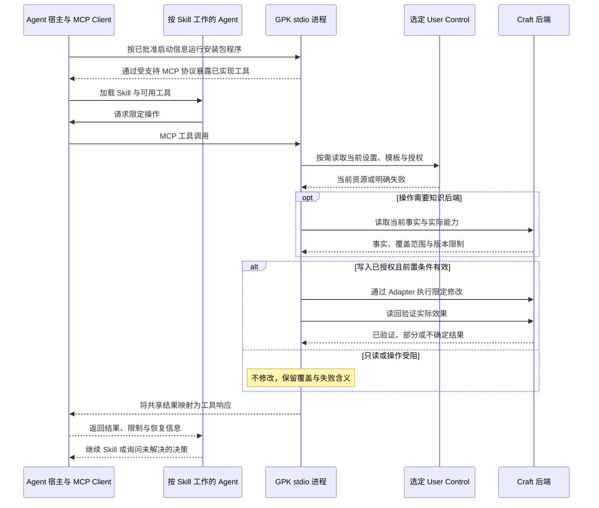
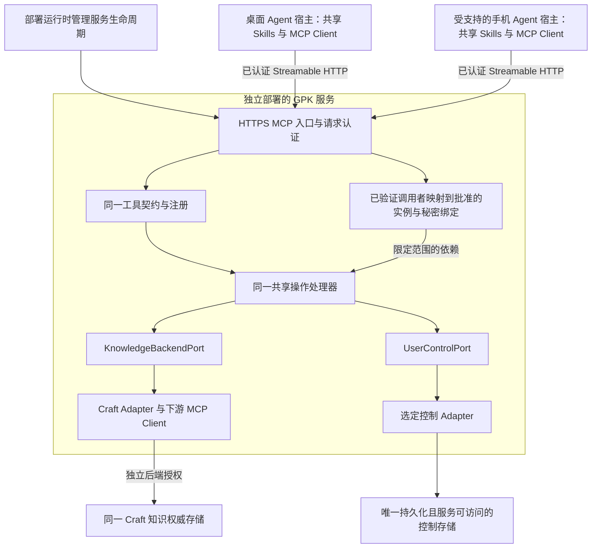

# 架构设计

本文是[英文架构](architecture.md)的中文辅助说明。先说明入口路由、Skill/工作流、领域
模型、存储端口与 Adapter 组成的逻辑架构，再展开组件实现、连接、操作执行与宿主集成。英文为权威正文，
当前支持范围只在 [README](../README.md#current-support)维护。实现示例不代表已交付的工具。

初始目标是一个人通过 Codex 或 Claude Code 使用 Craft 保存知识，使用明确选定的本地
`.gpk` 目录保存 User Control。领域含义独立于客户端和存储，
操作以用户当前记录为准，确定性规则由各工作流共用。架构不要求新的编辑器、知识镜像库、
托管的 GPK 服务或自建调度器。首个运行时版本**只实现 MCP stdio**；未来 Streamable HTTP
复用同一工具契约、领域操作和存储端口，是明确的扩展点，不是首期要同时实现的服务。

## 整体架构

Skill 是 GPK 的业务核心。宿主 Hook 把共享路由规则加载到 Agent 上下文，Agent 根据用户
意图选择对应 Skill；显式调用 Skill 也能直接进入业务流程。Skill 通过 Port 定义的操作
读取和修改知识及用户控制资源，具体 Adapter 为选定后端实现这些契约。

图中的箭头表示逻辑使用关系，不代表进程或协议调用。领域模型为 Skill、Port 和实现提供
共同的概念与规则。工作流操作 Project、Source、Wiki 等领域对象；更换符合契约的后端，
改变的是这些操作的实现方式。具体产品、传输协议与程序入口在后面的组件实现中说明。

### 入口路由与 Skill 核心

入口 Hook 是轻量的宿主绑定：在会话开始或上下文恢复时加载共享路由规则，并在宿主支持
时，为新用户消息注入简短的路由提醒。Agent 理解意图并加载选定 Skill；Hook 不单独运行
自然语言分类器、执行业务流程或为了路由读取整个知识库。

共享路由规则在业务 Skill 之前加载，各宿主通过实际支持的 Hook/指令机制交付同一套规则，
不维护各自的意图表。[共享路由规则](../plugin/rules/routing.md)维护选择与切换规则，Hook
与手动 `gpk` 入口都读取它；规则随加载器打包，详见[入口 Hook 加载](plugin-runtime.md#entry-hook-loading)。

Setup、Ingest、Plan、Work、Review 负责业务判断与流程编排。`gpk` 保留方法解释、查询和
显式兜底入口的职责，自动路由无需每次先加载它。工具绑定、操作处理器和 Adapter 提供
Skill 所需的可调用操作，不再实现另一套业务工作流。

路由启动与连接启动分工不同：加载指令无需后端连接，选定工作流按需解析当前资源和访问
能力。显式请求无需 Hook；宿主的 Hook 能力不同，需要分别验证对应绑定。交付边界见
[Hooks 与执行触发](#hooks-与执行触发)，当前支持仍由 [README](../README.md#current-support)维护。

### 例子：摄入一个 URL

用户说“帮我 ingest 这个 URL”，Agent 按已加载的规则选择 Ingest Skill，或经显式调用进入：取得输入，通过
`KnowledgeBackendPort` 读取相关的当前知识，判断材料的用途，再通过同一契约执行授权范围
内的 Source、Wiki、Project 或 Task 变更。相关个人偏好与授权由 `UserControlPort` 提供。
Skill 最后说明实际保存和集成了什么，以及有哪些限制；物理存储由后端实现负责。

外部 URL 正文由可用的来源读取器/宿主能力获取；已有知识的读取和持久化由知识端口承担，
Port 本身不意味着具备网页读取能力。用户不需要调用 GPK CLI。完整判断和路由规则见
[Ingest 工作流](workflow-design.md#ingest)。

## 核心组件

| 组件 | 职责与边界 |
|---|---|
| 入口 Hook 与路由规则 | 加载共享选择规则并刷新路由提醒；由 Agent 选择 Skill，Hook 内不执行业务操作 |
| Skills 与工作流 | 理解意图与当前上下文，判断相关性、成果和容量，通过领域操作编排 Setup、Ingest、Plan、Work、Review |
| 领域模型 | 定义所有工作流和后端共同遵守的实体、关系、状态和约束 |
| KnowledgeBackendPort | 定义领域事实与处理证据的读取和持久化操作，表达覆盖范围与实际效果 |
| UserControlPort | 发现选定控制入口，访问具名 Settings、明确用途的模板和独立授权契约 |
| 后端 Adapter | 为具体存储实现 Port，保持领域含义、当前用户内容与能力限制 |
| 宿主能力 | 执行 Agent、加载 Skill、提供工具、用户交互、来源访问与受支持的执行触发 |

Skill 负责语义判断；确定性代码校验能够确认的事实与效果。Port 定义所需能力，Adapter 实现
这些能力，接口索引见[存取端口](storage-contracts.md#public-contracts)。可执行模块是上述
职责的实现，用户无需理解其进程和传输细节。

## 领域模型如何进入运行时

[领域模型](../plugin/knowledge/domain-model.md)及其
[中文说明](../plugin/knowledge/domain-model.zh-CN.md)维护实体定义、关系、状态和操作约束。
下面展示运行时需要保持的关系，不规定数据库表或 Craft 文件夹结构。

Project 有一个主 Area，也可以关联其他 Area；Task 最多有一个主 Project，也可以独立存在。
证据和上下文关系可以多对多，Output 也可以服务独立目的。物理位置不等于逻辑归属。
Objective/KR 属于 Project 内容，不另设 Goal 实体；捕获内容、过程材料、链接与检查点是
辅助操作，Focus 和 Full Plan 是视图。

落实到实现：

- [领域类型](../src/domain/entities.ts)提供类型化引用和状态词汇；Adapter 必须实际解析
  引用的类型、范围与存在性，不能直接把原生 ID 强转为领域引用。
- 读取投影只包含消费者需要的含义，不能用它覆盖整份原生文档或丢弃未知内容。
- 各实体接口直接声明自己的操作，可以独立演进；具体原则见
  [知识操作契约](storage-contracts.md#3-knowledge-backend-port)。
- Area、Project、Task 各有生命周期；Source、Wiki、Output 没有统一生命周期。
  完整状态转换表留在领域模型中。
- 状态含义、存储编码、查询能力分开处理。能读写状态标签不等于能原生筛选；覆盖范围和
  查询保证由[存取契约](storage-contracts.md)约束。
- Agent/用户给出语义判断，程序检查所需当前事实与前置条件。合法转换既不代表授权，
  也不证明目标成果已经实现。

## 组件实现

下面解释初始集成如何实现上述逻辑架构。实现方式可以演进，但 Skill 对 Port 的逻辑依赖和
领域模型保持稳定。Craft 是首个知识后端目标，本地 `.gpk` 是首个 User Control 目标；
其他提供者需要各自的 Adapter 与验收证据。

### 运行时职责

| 职责 | 实现边界 |
|---|---|
| 路由启动 | 通过已支持的宿主 Hook/指令绑定加载共享 Agent 路由规则，按需刷新简短提醒 |
| 工具绑定 | 将宿主工具输入转换为共享操作请求，保留结果；初始实现采用 MCP |
| 连接启动 | 解析连接与最小 control locator，建立访问并构造限定范围的 Adapter，可早于控制资源存在 |
| 操作处理器 | 编排当前读取、授权、能力、领域校验、持久化和效果验证 |
| 校验与资源读取 | 按具体操作需要检查确定性规则、读取当前上下文与模板；Agent 做语义判断，Adapter 做原生渲染 |
| Provider Adapter 与传输 | 实现端口操作、编码原生内容，管理本地文件访问或已授权的下游 MCP/API 调用 |
| 平台集成 | 加载工具、路由指令与 Skill，取得用户输入，把受支持的 hook/执行器事件转成工作流意图 |

这些职责不要求各自成为独立模块、类或服务。先实现一个可工作的 MCP 操作及其具体本地
控制或 Craft Adapter，简单校验和资源读取可以留在该操作内；实际调用方需要同一规则时再提取共享函数。
实体和操作输入独立声明，具体原则见[存取端口](storage-contracts.md#public-contracts)。
通用工作流引擎、动态注册中心、事件总线和新 Harness Port 没有当前消费者。
实现指南见[Adapter 开发](adapters/README.md)。

### Adapter 在哪里运行

2026-10-01 的决定在 2026-10-08 细化为：**GPK 通过 MCP 工具提供共享操作和 Adapter 的
可执行实现。先实现 stdio，明确保留薄的 Streamable HTTP 入口；独立 CLI 仍是可选扩展。**
TypeScript 契约需要实际实现，调用协议和部署位置不进入领域模型。

MCP 绑定向 Agent 暴露已实现的操作，共享处理器调用 Port，启动模块提供具体 Adapter。
逻辑图中的 Skill → Port 不代表 Markdown 能直接调用 TypeScript 接口。工具名称和 schema
在实际实现时定义为 TypeScript 公共契约，端口声明本身不注册工具。

按本次明确要求，工程骨架先接通诊断工具与完整的 Adapter 空实现；存储方法明确返回
unsupported，不执行 I/O，不代表首个用户闭环完成。当前能力见
[README](../README.md#current-support)，实际代码布局见[插件组织](plugin-runtime.md)。

MCP Server 可以在宿主连接期间存活，但缓存的偏好、授权和实体不能成为权威事实，操作
仍通过选定连接与控制存储读取当前内容。面对宿主时它是 Server，访问 Craft 时是 Client，
两侧有各自的连接与授权。单独配置并验证的 API 是另一种 Provider 实现路径。

宿主分别管理各 MCP 连接。安装 Craft 与 GPK 两个插件，不代表 GPK 自动获得另一插件的
工具、会话或凭据。复用宿主连接需要显式支持并验证的桥接机制，依据见
[MCP 架构](https://modelcontextprotocol.io/docs/learn/architecture)及
[隔离原则](https://modelcontextprotocol.io/specification/2025-11-25/architecture)。
Manifest 配置工具，Skill 提供 Agent 方法；工具调用权限不替代具体操作与下游授权。

### 首期：本地 stdio

下面明确进程和部署边界，不要求所有知识后端都使用 MCP。两个获授权的客户端可以分别
启动 GPK 进程，共用用户选定的控制根目录和 Craft 实例，不依赖 Adapter 内的事实缓存。

**程序由宿主运行**，不是 Skill 执行 CLI，也不是 Port 自己运行。Agent 读取 Skill 后请求
工具，宿主 MCP Client 发送协议消息，GPK 工具绑定调用共享处理器，再通过 Port 使用
具体 Adapter。对应宿主机制见 [Codex MCP](https://learn.chatgpt.com/docs/extend/mcp?surface=cli)
与 [Claude Code MCP](https://code.claude.com/docs/en/mcp)。

首期要求：

- 每个安装包携带一份可执行 Node 入口及运行依赖，不复制进每份 Skill 的引用资料。
  脱离源码仓库也能启动；正常使用不依赖独立 CLI、临时下载依赖或 TypeScript 编译器。
- 启动信息明确实例、根目录与受支持的秘密绑定。没有 Settings 或 Craft 连接时也能
  启动 Setup/诊断；不猜目录，不从工具参数推断授权。
- stdout 仅输出协议，脱敏诊断走 stderr；处理 stdin 关闭、取消和退出，不假称撤销了
  已在后端执行的写入。
- 每个操作重新读取所需的当前设置、授权和后端事实。两个宿主进程是独立写入者，
  单进程锁不提供跨客户端或用户原生修改的保护。
- Agent 判断、来源读取、Hook 和用户调度仍属于宿主集成；常驻 MCP 进程不自动成为
  Agent、会话读取器或调度器。

### 启动与操作时序

以下发现过程是概念表达，实际握手由 SDK 按客户端支持的协议处理，不固定要求某个握手。

图中以知识写入为例。Setup 修改控制资源时走控制 Adapter，独立读回验证，不与 Craft
构成原子事务；对话中的确认文字本身也不是可信授权。

### 后续扩展：Streamable HTTP

HTTP 替换的是 **GPK 面向宿主的工具入口**，不是 Craft Adapter，也不要求新建 Agent
Harness。要在电脑离线时使用手机，服务必须独立运行且手机可以访问；localhost HTTP
本身不能提供这个能力。

这是扩展目标，不承诺某个手机客户端已经支持 GPK Skills 或能读取桌面的会话文件。
Agent 仍在用户选择的客户端执行语义工作流；服务只提供操作，不内置另一个 LLM Agent。

| 边界 | 首期 stdio | HTTP 扩展 |
|---|---|---|
| 生命周期 | 宿主启动/停止本地 Node 子进程 | 部署运行时管理独立服务 |
| 工具入口 | stdin/stdout | Streamable HTTP，验证协议兼容性 |
| 调用者范围 | 可信、已批准启动信息与当前操作授权 | 每次请求验证身份，服务端映射到批准实例，仍检查当前授权 |
| 共享行为 | 工具 Schema、操作、领域规则、存储端口 | 复用语义与验收用例 |
| 控制存储 | 唯一明确选定的桌面 `.gpk` | 唯一服务可访问的持久存储；单用户可复用持久卷上的文件 Adapter |
| Craft 访问 | 桌面 Adapter 独立授权 | 同一 Adapter，服务端重新绑定秘密与访问，不继承桌面登录 |
| Agent 能力 | 宿主 Skills、Hooks、读取器与调度 | 仍由具体宿主提供，HTTP 不转移这些能力 |

扩展点使用普通依赖注入：入口取得**可信且限定范围的执行上下文**，装配选定 Adapter，
调用同一工具注册与共享操作。领域输入不含本地路径、token、SDK 请求对象或协议会话
状态；模型传来的用户 ID、授权或根目录不是可信身份。具体 TypeScript 签名随首个实际
消费者实现，不在文档中再增加推测性的 Port。

协议使用[官方 TypeScript SDK](https://github.com/modelcontextprotocol/typescript-sdk)，版本
在验证两个初始宿主后固定。MCP 协议日期、SDK 主版本和 JSON-RPC 2.0 不是同一版本体系。
[2026-07-28 协议](https://blog.modelcontextprotocol.io/posts/2026-07-28/)的无状态核心不代表
客户端都已升级；兼容状态和常驻进程都不能持有 GPK 的权威事实/授权。
未来使用 [Streamable HTTP](https://modelcontextprotocol.io/specification/2026-07-28/basic/transports/streamable-http)，
不另造 REST 领域 API，也不采用旧 HTTP+SSE 传输。

### 实现边界与迁移步骤

首期按 stdio 纵向闭环实现：可独立安装的程序与诊断 → 本地控制与可重复 Setup →
限定 Craft 读取 → Plan/Work 守卫写入 → Ingest、Review、真实宿主触发处理。
随实际闭环增加模块，不预建 HTTP 空 Adapter，不复制处理器，不增加通用工作流/传输框架。

后续 HTTP 必须完成：

1. 用薄 HTTP 入口包裹同一工具与处理器，两种入口运行同一验收用例，包含部分/不确定结果。
2. 先验证请求身份和 endpoint/origin 暴露边界，再选择实例；每次验证 token 与资源范围，
   不以客户端 metadata 或记住的连接替代身份。认证服务可以外置，不要求自建账号体系，
   参见[远程 MCP 认证](https://developers.openai.com/plugins/build/auth)。
3. 选择服务能访问的持久 User Control，在服务端重新绑定后端授权与秘密。单用户服务可
   复用持久卷 `.gpk` 的文件 Adapter；实际部署需要时再选数据库/服务型 Adapter。
   临时文件系统不能成为权威存储。
4. 预览、迁移、验证并明确切换控制资源和客户端 locator，重新评估授权与秘密引用。
   不自动回退本地、不保留两个独立写入的控制权威，也不暗藏同步。Craft 事实继续留在 Craft。
5. 在实际桌面/手机客户端验证独立重启、撤权、身份隔离、并发编辑、请求中断和重试。
   重试前检查持久效果，无状态协议不等于恰好执行一次；安全并发不足必须明示。

首期不实现 HTTP listener、公网部署、远程认证集成、多用户服务、云同步或自建 Agent/
调度器，这些不是 stdio 完成的前提。具体用例由[验收清单](conformance-scenarios.md#implementation-acceptance)
管理，产品里程碑由[Roadmap](roadmap.md)管理。

### 可选的 CLI

只有实际终端、脚本或诊断需求出现时，才增加独立 CLI。安装、Setup、正常 Skill 工作流及
首个运行时里程碑都不依赖它。宿主通过启动命令运行 MCP Server，也不代表必须交付一套
面向用户的 GPK CLI 命令。

如果增加 CLI，例如 `gpk projects list --json`，它与 `gpk_projects_list` MCP 工具必须
调用同一处理器、共用连接配置。展示格式可以不同，领域结果、覆盖范围、限制、验证和恢复
信息必须一致。MCP 工具不能依赖调用 CLI 子命令来实现功能，Skill 也不依赖 CLI 的存在。
支持多种入口是扩展规则，不代表必须同时交付所有入口。

## Setup 与连接生命周期

Setup 先选择并读取本地控制存储，再建立知识后端访问。安装 Craft 插件不是前提；已有的
Craft MCP 服务地址可能可以继续使用，但宿主的登录状态不一定能转交。Craft 支持
[为其他客户端配置 MCP 连接](https://support.craft.do/en/integrate/mcp)，实际认证方式和
能力仍需检查。

1. **选择并检查本地控制存储。** 明确实例及稳定的 `.gpk` 根目录，验证文件访问权限并读取
   当前 Settings。不扫描整台机器、不隐式向父目录查找，也不为每个 Project/客户端建一份。
   控制根目录不是插件安装/缓存目录；已知资源缺失、无权限或格式错误需恢复，不能视为新安装。
2. **选择知识连接方式。** 使用已有 active 配置或用户首次指定的后端。检查宿主是否明确
   提供已授权、受支持的连接桥接；仅在其范围
   内使用。不能因为看见工具名就假定能桥接，也不读取另一插件的私有 token 文件。
3. **必要时配置直连。** 用户指定 Craft MCP 地址并为 GPK 完成所需认证。适合时复用同一
   服务地址，独立客户端可能仍需登录。API 是单独配置并验证的选项，MCP 失败不能自动切换。
4. **验证后端访问。** 建立协议连接、检查实际操作、确认 Provider/space 身份并验证范围内读取。
   可读不代表可写或能看见整个空间；写探测也需要单独限定的授权。
5. **保存启动信息并完成业务 Setup。** 宿主/本地只保存选定控制根目录的 locator，以及
   秘密／连接 profile 的本机绑定，不复制第二份 Settings。含凭据或能力令牌的地址使用秘密
   引用，输出需脱敏。各运行入口共用启动信息，可选 CLI 不需第二次配置。
   验证布局及所选资源后，再初始化/更新 Settings，按[Setup 工作流](workflow-design.md#setup)
   采用用户实际要求的个人模板，并读回验证。本地控制与 Craft 写入是独立效果。
   连接成功本身不触发模板
   创建、迁移、项目启动或任务调度。
6. **分别报告就绪情况。** 区分传输可用、control authority 已选定和具体操作能力。部分失败
   时保留有效连接并恢复资源，不宣称整个实例已完成配置，也不盲目重复创建。

控制资源尚不存在时，可以依据当前用户/宿主授权执行限定的初始 Setup 操作。这不代表生成
了持久授权或允许后续所有工作；后续操作仍使用当前授权与已选定的控制存储。

后续调用复用配置，凭据按所选机制刷新；失效或撤销后停止依赖操作，必要时重新认证。
重复 Setup 验证和修改选定配置，不重置实例。已知控制存储访问失败不代表这是新安装。

启动信息先提供明确选定的本地根目录，文件布局与范围见[本地控制映射](adapters/local-control.md)。
Settings 保存后端选择及安全的 MCP/API
连接描述，敏感地址与凭据只保存宿主秘密引用；启动信息只负责找到控制入口，不复制整份配置。
个人模板、持久授权和来源策略仍在选定存储，个人背景在可选个人 Wiki 或 Area/Project，详见
[数据归属](storage-contracts.md#1-two-storage-ports-and-the-host-boundary)。同一电脑上获授权的
Codex 与 Claude Code 共用该根目录，不复制 Settings。Craft 离线不影响读取本地设置与模板，
但依赖知识后端的操作需停止，不能重置本地配置。手机/云端不能自动访问桌面文件；远程部署
选择服务能访问的持久控制存储，按上面的 HTTP 扩展明确验证后切换，不做隐式同步/回退。
服务型 Adapter 是选项，不是使用 HTTP 就必须替换文件 Adapter。
知识库型不属于首期目标；只有原生扩展/插件私有配置空间合适时才重新考虑，不把控制配置混入
用户日常知识文档。仅宿主内可用的桥接不能证明其他执行环境也能访问。

Setup Skill 必须能通过宿主的 GPK 工具和用户交互完成配置。运行时在尚未连接后端时也能
启动，先提供连接配置和诊断操作，再开放就绪的存储操作；不要求用户执行 `gpk setup`。
首个实现需要为支持的执行环境选定实际启动配置与秘密管理机制，并验证工具绑定；本设计
不隐含自建凭据数据库或提取宿主 token。

### 分层 Settings 与 Onboarding

[UserControlPort](../src/domain/user-control-port.ts) 改为具名的 Settings、模板与授权
操作，不再暴露任意 KV。Settings 按偏好、后端选择／配置、每个后端的布局位置、模板引用和
自动沉淀策略分层。布局不是领域 Schema，也不决定归属。可以保存多个明确配置，但只选择
一个 active 后端；不表示联邦查询或失败自动回退。Agent 能力来自当前宿主，不额外配置 Agent ID。

统一模板操作服务于 Area、Project、Task、Source、Wiki、Output；Settings 提供六个具名引用，
null 使用对应的内置默认。创建时明确用途，正文更新不改变用途，绑定时验证引用、用途及内容。
六类默认均有中英文版本，不必创建六份个人模板或实体文档。Task 只是轻量内嵌片段。
模板选择与保存不等于原生渲染或领域写入已实现。

Setup 是主要配置读写流程，插件 Onboarding 是其首次初始化路径。成功意味着真实后端连接、
布局和已选资源经验证，有效完整 Settings 初始化并读回，而非独立的 completed 布尔标记。
默认语言 en、使用内置模板、关闭自动沉淀及其 Daily Notes；位置、授权和访问能力不能虚构。
不强制个人 Profile 或开启自动化。后续认证失效需要重连，不代表初始化被清空。

以下是 **GPK → 知识后端**的连接配置，不是首期 GPK 的宿主入口：
HTTP MCP 可配置安全公开地址或秘密引用；stdio 使用已批准的宿主连接 profile；桥接需真实
支持的明确引用；API 需单独选择验证。声明配置形式不代表实现或支持。换宿主可能需要重新
绑定／授权逻辑秘密引用，不能复制 token。普通配置更新不授予权限、不自动执行命令；后端及
控制存储切换需明确验证，不自动搬迁事实、模板或授权。

## 工作流与操作执行

### 统一执行链路

进入操作链路前，入口路由已经选定业务 Skill。这里选择具体操作属于工具分发，不再进行
一遍自然语言 Skill 路由。

Skill 编排已实现的操作，每个操作先用普通函数实现，工具绑定负责转换输入并保留结果。
简单读取可以直接调用 Port。下表是行为检查清单，不要求 pipeline 接口或中间件对象链。
可选的新入口调用同一操作。公共类型由实际 TypeScript 消费者定义，存储契约继续由
[src/domain](../src/index.ts)维护。

| 阶段 | 实现工作与停止条件 |
|---|---|
| 解析与分发 | 校验外部输入，选择已实现操作，明确读写意图；无效输入不能进入写入 |
| 连接与绑定 | 解析连接和 control locator，构造限定范围的 Adapter；连接 Setup 可早于控制资源存在 |
| 读取当前事实 | 按需读取资源、目标、依赖和真实能力；不完整发现不能证明不存在、唯一或已全面审查 |
| 判断与守卫 | 获得必需的 Agent/用户判断，检查当前授权、领域规则与实际版本保证；缺少判断就返回调用方 |
| 执行 | 经端口调用 Adapter，验证原生数据并窄范围编辑；不隐式扩权、切换 Provider 或级联操作 |
| 验证与恢复 | 读回效果，必要时保存已验证进度；不确定写入先检查，成功步骤不重复执行 |
| 呈现 | 向调用 Skill/工具消费者返回领域结果、覆盖范围、部分失败与恢复信息 |

共享授权和约束也在端口实现边界执行，直接调用 Adapter 不能绕过。前置检查与写后验证是
必经步骤，不能依赖可选 hook 才生效。

### 核心操作族

| 操作族 | 实现落点 |
|---|---|
| Setup/连接诊断 | 建立并检查传输，发现/选择控制入口，采用资源，分别报告读写能力 |
| 读取/列表/搜索 | 解析类型化引用，查询并处理分页，分别保留发现覆盖范围和单条内容覆盖范围 |
| Area | 持久化方向、状态、关系变更；复盘判断由 Agent 提供 |
| Project | 组合创建、主 Area、任务排序、过程材料和经过判断的状态转换 |
| Task | 处理已接受行动、所属项目、单一计划时间、状态及有用结果回流 |
| Source/Wiki/Output | 持久化证据、解释、成果引用；准备、综合和保留判断由工作流提供 |
| 捕获/链接/检查点 | 操作原生捕获面、普通关系与已验证处理进度，不提供绕过领域约束的原始内容后门 |
| 用户控制/模板 | 读写选定资源，区分未配置与访问失败，创建前解析当前模板 |
| 保全操作 | 在引用和恢复保证成立时组合归档、恢复、删除与重组 |

具体端口源码链接见[英文操作清单](architecture.md#core-operation-families)。这张表不新增
公共接口，也不要求每个领域操作都对应一个命令。Setup、Ingest、Plan、Work、Review 由
Agent 编排这些操作；程序入口必须说明自己执行其中哪一段。需要解释、综合或成果判断的
触发任务，必须有实际 Agent 执行环境；Node 进程本身不会提供模型或完成 Ingest/Review。
详细判断与停止边界归[工作流设计](workflow-design.md)。

### 列出所有 Project

Skill 通过运行时工具进入列表处理器，调用已绑定 Adapter 的查询能力。Adapter 根据实际策略枚举或
搜索，处理需要的分页，读取当前内容，识别类型/状态并应用所有条件，再返回项目和覆盖范围。
“全部”意味着在预算内继续遍历，不意味着有限搜索自动获得完整性。分页结束也不证明搜索
没有漏项。访问不到、预算耗尽、状态未解析等限制必须如实返回，不因调用方式改变；查询不修复状态。
英文正文包含该调用链的时序图。

### 创建 Project 与计划

Plan Skill 形成 Objective/KR、选择主 Area、读取当前承诺并取得所需的启动决定。运行时解析
当前模板，检查引用与渲染能力，创建项目，再按需要创建/分配任务、保存顺序、材料和链接。
每一步返回真实引用并独立验证。项目已创建但任务失败时，报告已保存部分，恢复剩余步骤；
不能再建一个项目。保存计划与建立执行承诺是两种结果。

### 完成 Task 与关闭 Project

Work 提供经过判断的任务结果；处理器读当前任务与相关上下文，记录结果，再持久化合理的
状态转换。结果写入成功而状态失败需要分别报告。外部成果与实际执行由可用宿主能力验证，
GPK 写入成功不证明外部工作发生，也不自动完成父项目。

项目关闭需要 Review 的成果判断及剩余任务处置。取得足够覆盖的当前任务与项目证据，执行
约定的任务变更后，才能持久化项目转换。证据不足或前置效果未完成就停止关闭。代码检查判断
所需的内容与一致性，不根据标题或勾选推断 KR 达成；首个实际调用方必须据此修订草案写接口，
不能把一个 reason 字符串当作充分证据。

### 摄入部分成功后的恢复

读取器提供限定范围、可追溯的输入。Ingest 解析作品身份，读取后端进度，区分输入变化与已
完成的目标效果；Agent 完成准备和语义路由，处理器保存具体变更。采集与集成进度分别在验证
后推进。Source/Project 成功、Wiki 失败时，检查当前效果并只恢复 Wiki。传输层不能盲重试
不确定写入，检查点不是锁，也不提供恰好一次保证。详见
[来源处理与恢复](workflow-design.md#5-generic-source-processing-and-periodic-execution)。

## Hooks 与执行触发

### 用户自动化与产品内部处理

按用户要求的业务行为和责任归属划分，不按底层是否用了定时器或 Hook 划分：

- **用户请求的自动化**：例如“每天按这些规则清理 Inbox”或“每天根据 Session 更新
  周报”。使用选定 Agent harness 支持的 scheduler 调用对应 GPK Skill；目的、业务
  节奏和规则属于用户选择。不支持时明确报告，不默认增加 GPK 调度器或服务来接管请求。
- **产品内部机制**：例如启用“会话自动沉淀”。GPK 负责变化捕获、批处理、摄入、去重、
  恢复及集成生命周期；Hook、定时器或组合都是实现选择。用户不必自己创建和维护周期
  业务任务。底层复用宿主 scheduler 不改变责任归属，内部处理间隔也不使它变成用户任务。

启用功能时明确来源、留存和下游操作范围，不意味着允许采集所有会话或扩权。用户可以
开启、关闭功能并了解结果与异常，无需管理内部触发方式。关闭或撤销权限后停止相关
处理并核对自身注册，不影响无关的用户自动化。策略和注册引用留在 User Control；输入及
已验证/待完成效果留在 Knowledge Backend；实际触发状态由执行它的宿主/运行时持有，
不能变成 Adapter 的事实数据库。

两条路径复用同一 Skill 和操作守卫，不新增业务 Skill、领域实体，也不默认自建时间
调度服务。语义 Ingest 仍需要实际 Agent 执行环境，定时器或常驻 MCP 进程本身不能提供。
验证功能声明的执行范围与补偿行为，不隐瞒执行不可用。

### 触发投递与操作边界

入口路由、外部工作流触发、操作内部必经阶段，需要按各自的消费者与效果区分。

| 机制 | 职责与实现边界 |
|---|---|
| 会话/上下文 Hook | 在选择业务 Skill 前加载共享路由规则；只注入指令，不执行业务或隐式扫描后端 |
| 用户消息 Hook | 提醒 Agent 按已加载规则选择或继续工作流；只保留简短提醒，不复制意图表或单独分类 |
| 内部前置检查/写后验证 | 普通操作代码，始终执行授权、约束、读回，不能因为没注册 hook 而跳过 |
| 宿主生命周期/工具 hook | 将受支持事件转成限定意图，例如上下文刷新、结果回流或摄入；含义由共享工作流处理 |
| 用户请求的定时触发 | 选定 harness scheduler 按用户要求的业务节奏调用对应 Skill，并持有实际任务状态 |
| 内部功能触发 | GPK 管理已实现的 Hook/定时器集成和处理生命周期，处理启用功能的会话变化；不作为用户业务任务 |
| 手动调用 | 进入同一工作流/操作；无需 hook，但不能替代定时执行验收 |

会话与消息 Hook 为 Agent 路由准备上下文；来源/工具事件与执行器请求限定的工作流。
Hook 输出和选中 Skill 都不扩权，工作流读取当前授权，每个操作执行自身守卫。加载规则
不建立连接、不初始化 User Control，也不注册周期任务。

实现中的绑定需要进度或结果展示时再接入，不提前建设回调注册层。
写入已验证后的报告失败需要单独说明，不能因此撤销或重复写入。

会话可用、新输入到达、工具执行结束只是候选事件，不代表两种客户端都有同名 hook。
工具结束也不能证明 Task 已完成。实际事件名、payload、注册配置和投递保证，在平台集成
实现时确定并验证。缺少 hook 时手动路径仍可用，相关自动化能力明确不可用。

Hook/执行器传入限定的实例、来源范围与意图。每次触发重新读取当前授权和后端进度，重复、
乱序或离线事件按当前事实处理；按策略排除生成的回执和成果，避免自触发循环。未知 payload
或不明确授权停止本次相关操作，来源正文不能扩权。

注册 hook/定时任务需要相应的用户请求或功能启用授权。宿主/运行时保存实际注册，
User Control 保存意图策略和注册引用。策略关闭或权限撤销后，迟到事件不能继续执行。
MCP Server 持续运行不等于调度器，下次会话补做不能替代明确要求的定时运行。
需要 Agent 判断的任务必须有实际 Agent 执行环境；详细行为见
[周期执行契约](workflow-design.md#5-generic-source-processing-and-periodic-execution)。

## 数据归属、失败与恢复

[存取契约](storage-contracts.md)统一规定数据权威和效果保证：领域事实与处理进度留在
Knowledge Backend；个人资源和授权留在选定 User Control；连接启动信息与实际任务注册由
实际执行的宿主/运行时管理（首期在桌面，远程部署时在服务环境）。Adapter 不拥有持久化
真相，选定控制存储与 Craft 的写入独立，不能承诺
跨存储原子化。

错误在工具调用与工作流触发中保持相同含义。校验/访问失败阻止对应写入；部分失败或不确定失败
可能已经产生效果。重试前重新读取，保留用户修改，分别报告已验证、待处理与冲突结果。
进程内串行化不能阻止其他客户端修改；无人值守并发写入需要真实执行器/后端协调保证，否则
不能宣称支持。取消调用或进程消失不等于撤销写入。

诊断报告操作、阶段、范围、限制与恢复建议，不倾倒凭据或私人正文，也不能污染工具协议流
或可选 CLI 的机器输出。日志不替代后端恢复证据。

## 代码与打包边界

| 位置 | 归属 |
|---|---|
| `src/domain/` | `entities.ts` 保存实体、引用和状态；两个 `*-port.ts` 保存知识库与用户控制操作契约；`operation-types.ts` 保存共用输入和结果类型；共享确定性规则随实际实现加入 |
| `src/adapters/` | 完整的 Port 实现；本次明确要求的骨架返回 unsupported，真实 I/O 验证后再开放操作 |
| `src/runtime/` 与 `src/mcp/` | 协议无关的处理器与启动装配、工具 schema／注册及 stdio 入口 |
| `plugin/` | 运行时 Agent 实际读取的共享路由规则、Skills、领域指引、流程与模板 |
| `platforms/` | 宿主元数据与入口 Hook 加载配置；工具加载配置随首个实现交付 |
| `docs/` | 设计、证据、验收、交付说明 |
| `dist/` | 类型、安装包和归档三个独立管理的生成产物 |

领域数据与操作契约放在一起。`Port` 表示由适配器实现的接口角色，不要求独立层级或目录。
依赖方向是具体 Adapter → 领域契约；领域内部的契约使用实体与共用操作类型。
运行时装配具体 Adapter，处理器面向契约。领域代码不导入宿主 SDK、Craft API、CLI
解析器或 MCP SDK。实际入口直接调用共享处理器，不复制规则，也不解析对方的展示文本。

可执行代码交付时，需要构建并携带运行依赖、显式注册实际入口、验证独立安装；可选 CLI
只有实现后才需要打包。类型声明或 Manifest 字段本身不能产生可用工具。不编辑生成文件，
不把设计占位 Skills/Adapter/hooks
放进产品。文件与加载归[插件运行说明](plugin-runtime.md)，构建发布归
[分发说明](distribution.zh-CN.md)。

## 交付与验证

按实际可用链路交付：共享入口路由与经过验证的宿主加载器；Skill 经 MCP 工具调用一个能访问 Craft 的范围内读取操作；通过宿主
完成可重复 Setup 与当前模板发现；支持 Plan/Work 的受控操作；再到 Ingest、Review 和
自动执行。[Roadmap](roadmap.md)维护产品里程碑与完成条件，读写契约状态见
[端口说明](storage-contracts.md#public-contracts)。

验证区分共享规则、工具与处理器等价、真实 Provider、Agent 工作流和安装后宿主执行。
[统一验收清单](conformance-scenarios.md#implementation-acceptance)维护连接 Setup、工具
等价和 hooks 等用例。覆盖实际入口、用户直接修改、响应丢失、权限撤销、新进程与真实触发。
可选 CLI 或其他入口实现后，再补跨入口等价验证。
包检查不能证明 Craft 效果、工作流完成或跨宿主可移植性。

具体秘密管理设施、Provider 协议与宿主事件/执行器需在各集成中选择并证明，不能因此改变
领域含义或隐式切换权威存储。证据记录到对应 Provider/场景，不从架构图推导“已支持”。

## 文档权威与私人上下文

架构页维护运行时组合和执行机制。用户需求归[需求场景清单](requirements.zh-CN.md)，
领域定义归领域模型，工作流判断归 workflow-design，
签名归 TypeScript，存储行为归 storage-contracts，具体映射归 adapters，验收归
conformance-scenarios，当前支持归 README。完整导航见
[英文文档归属表](architecture.md#one-authoritative-body-per-subject)。

修改要求时先改所属正文，再更新摘要、映射和检查，不留下两个现行规则。英文为主稿，中文
辅助解释；实际能力不足必须如实报告，生成包从源文件构建。

产品规范、设计、代码和草稿留在仓库并能独立评审。私人 Project、个人背景、研究历史和复盘
留在选定知识库。仓库不能携带所有者真实 Area、责任、财务动机、私人 OKR 或时间分配；
通用概念和虚构示例足以解释设计。

私人记录可以引用仓库成果；分发内容不能依赖私人笔记 URL、ID、标题、个人工作区路径或
“参见私人文档”。获准的产品要求和推理直接写入正文，链接仓库或公开来源。删掉私人链接
不代表可以公开个人背景。每份成果保留一个权威正文，Project/Task 保存摘要与成果/修订
链接；临时上下文不能成为第二份项目、任务或配置数据库。
